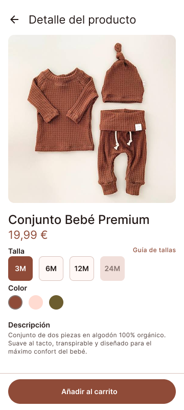

# Kidwear — Tienda de Moda Infantil
> **Diseño de Interfaz y Prototipo Interactivo Móvil con Material Design 3**

---

## Vista previa destacada

  
  
<em>Pantalla de detalle de producto (360 × 800 px) con selección de tallas y acción principal de compra.</em>

---

## Accesos al proyecto en Figma

* **Archivo de diseño en Figma:** [Abrir archivo de trabajo en Figma](https://www.figma.com/design/Vng2lm65JGTlWUGvX2h2jm/T1-%C2%B7-Kidwear-%C2%B7-David-Alonso-Aguilar?node-id=22-259&t=j0al9vocDoox1Y0L-1)
* **Prototipo interactivo navegable:** [Ejecutar prototipo en Figma](https://www.figma.com/proto/Vng2lm65JGTlWUGvX2h2jm/T1-%C2%B7-Kidwear-%C2%B7-David-Alonso-Aguilar?node-id=22-260&p=f&viewport=-890%2C1878%2C1.22&t=Y27BqCvMxc53LKZN-1&scaling=scale-down&content-scaling=fixed&starting-point-node-id=22%3A260&page-id=22%3A259)

---

## Índice de contenidos

1. [Justificación del diseño](DOCUMENTACION.md#1-justificación-del-diseño)
   * [1.1 Importancia del diseño centrado en el usuario](DOCUMENTACION.md#11-importancia-del-diseño-centrado-en-el-usuario)
   * [1.2 Objetivos y metas del proyecto](DOCUMENTACION.md#12-objetivos-y-metas-del-proyecto)
   * [1.3 Beneficios esperados](DOCUMENTACION.md#13-beneficios-esperados)
2. [Investigación y análisis de usuarios](DOCUMENTACION.md#2-investigación-y-análisis-de-usuarios)
   * [2.1 Datos demográficos y segmentación](DOCUMENTACION.md#21-datos-demográficos-y-segmentación)
   * [2.2 Personas](DOCUMENTACION.md#22-personas)
   * [2.3 Análisis de la competencia](DOCUMENTACION.md#23-análisis-de-la-competencia)
   * [2.4 Insights y hallazgos clave](DOCUMENTACION.md#24-insights-y-hallazgos-clave)
3. [Diseño de la interfaz](DOCUMENTACION.md#3-diseño-de-la-interfaz)
   * [3.1 Mapa de navegación](DOCUMENTACION.md#31-mapa-de-navegación)
   * [3.2 Wireframes](DOCUMENTACION.md#32-wireframes)
   * [3.3 Guía de estilo Material Design 3](DOCUMENTACION.md#33-guía-de-estilo-material-design-3)
   * [3.4 Prototipo de alta fidelidad](DOCUMENTACION.md#34-prototipo-de-alta-fidelidad)
4. [Validación y pruebas](DOCUMENTACION.md#4-validación-y-pruebas)
   * [4.1 Metodología](DOCUMENTACION.md#41-metodología)
   * [4.2 Resultados](DOCUMENTACION.md#42-resultados)
   * [4.3 Iteraciones y mejoras](DOCUMENTACION.md#43-iteraciones-y-mejoras)
5. [Entrega y documentación final](DOCUMENTACION.md#5-entrega-y-documentación-final)
   * [5.1 Justificación del diseño propuesto](DOCUMENTACION.md#51-justificación-del-diseño-propuesto)
   * [5.2 Recomendaciones y pasos a seguir](DOCUMENTACION.md#52-recomendaciones-y-pasos-a-seguir)
6. [Referencias bibliográficas](DOCUMENTACION.md#6-referencias-bibliográficas)

---